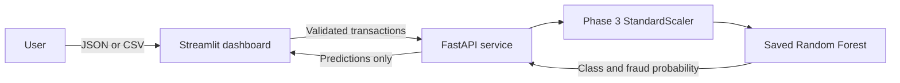

# 🛡️ Credit Card Fraud Detection

### A deployed machine learning demo for screening card transactions

Explore a Streamlit dashboard connected to a FastAPI inference service. The service loads a saved Random Forest model and its matching preprocessing artifact to return a fraud probability for each transaction.

<p align="center">
  <a href="https://credit-card-fraud-detection-mlops-pkjv6565lv6plygkaapkvt.streamlit.app/"><strong>🚀 Open the Live Demo</strong></a>
  &nbsp;·&nbsp;
  <a href="https://credit-card-fraud-api-u5gy.onrender.com/docs">API Docs</a>
  &nbsp;·&nbsp;
  <a href="https://credit-card-fraud-api-u5gy.onrender.com/health">API Health</a>
</p>

<p align="center">
  
  
  
  
  
</p>

> **Portfolio demo only.** Use synthetic or otherwise non-sensitive values. The public API has no authentication or rate limiting and must not be used for real-world fraud decisions. The free API service can sleep when idle, so its first response may take 50 seconds or more.

---

## ✨ What this project does

The dashboard offers two ways to try the model:

- **Single transaction:** Enter the 30 required features as JSON and view the predicted class, fraud probability, and decision threshold.
- **Batch CSV:** Upload a CSV with the required features. The dashboard validates it, sends rows to the API in chunks, and displays summary counts and prediction results.

The dashboard is a client for the API. It does not load or retrain the model. The API serves the already-trained Random Forest and applies the saved preprocessing steps before inference.

## 🧭 Architecture



## 📊 Held-out test performance

The selected Random Forest was evaluated once on a held-out test split. The test set was not used for model selection or threshold tuning.

| Metric | Score |
|---|---:|
| Precision | **97.14%** |
| Recall | **71.58%** |
| F1 score | **82.42%** |
| PR-AUC | **79.63%** |
| ROC-AUC | **92.46%** |

The held-out split contains **56,746 transactions**, including **95 fraud cases**. At the initial decision threshold of `0.5`, the confusion matrix is:

| Actual \ Predicted | Legitimate | Potential Fraud |
|---|---:|---:|
| Legitimate | 56,649 | 2 |
| Fraud | 27 | 68 |

Precision and recall describe different tradeoffs: high precision means most transactions flagged by this model were fraud in this test set; recall indicates how many of the test-set fraud cases it detected. These results describe this evaluation only and do not establish how the model will perform on other data.

## 🔬 How inference works

The API requires exactly **30 finite numeric features**:

- `Time`
- `V1` through `V28`
- `Amount`

The saved Phase 3 `StandardScaler` transforms `Time` and `Amount`. The PCA features `V1`–`V28` pass through unchanged. The Random Forest returns a fraud probability; the API compares that probability with the initial threshold of `0.5` to produce a class:

- `0` — `Legitimate`
- `1` — `Potential Fraud`

The prediction response includes the class, label, fraud probability, and threshold.

## 🖥️ Try the live demo

1. Open the [Streamlit dashboard](https://credit-card-fraud-detection-mlops-pkjv6565lv6plygkaapkvt.streamlit.app/).
2. Check the API connection in the sidebar.
3. Enter a synthetic transaction in the individual transaction tab, or upload a synthetic CSV in the batch tab.
4. Review the prediction and probability.

The API may need time to wake if it has been idle. Do not submit real cardholder or transaction information.

## 🔌 API reference

The hosted service has interactive documentation at [`/docs`](https://credit-card-fraud-api-u5gy.onrender.com/docs).

| Method | Endpoint | Purpose |
|---|---|---|
| `GET` | `/` | Service information |
| `GET` | `/health` | Confirms the model and preprocessing artifacts loaded |
| `POST` | `/predict` | Predicts one transaction |
| `POST` | `/predict/batch` | Predicts a bounded batch of up to 5,000 transactions |

Requests with missing or extra fields, invalid numbers, or non-finite values are rejected. Validation errors do not echo submitted feature values. Batch responses contain predictions; the dashboard’s displayed results and downloads contain row numbers and predictions rather than input features.

## 🧰 Run locally

### Requirements

- Python 3.13.5
- The project files, including the saved model and preprocessing artifacts

From the project root, create an environment and install the local dependencies:

```powershell
python -m venv .venv
.\.venv\Scripts\python.exe -m pip install -r requirements.txt
```

### Start the API

In the first PowerShell terminal:

```powershell
.\.venv\Scripts\python.exe -m uvicorn api.main:app --host 127.0.0.1 --port 8000
```

Confirm it is ready at [http://127.0.0.1:8000/health](http://127.0.0.1:8000/health). Open [http://127.0.0.1:8000/docs](http://127.0.0.1:8000/docs) to explore the API.

### Start the dashboard

In a second terminal, from the project root:

```powershell
.\.venv\Scripts\python.exe -m streamlit run dashboard/app.py
```

Open the Local URL printed by Streamlit, usually [http://localhost:8501](http://localhost:8501). The dashboard’s FastAPI base URL should be `http://127.0.0.1:8000`.

### Run tests

```powershell
.\.venv\Scripts\python.exe -m pytest -q
```

The test suite uses synthetic values and does not modify the source or processed datasets.

## ☁️ Deployment

- **API:** Render free web service, configured by [`render.yaml`](render.yaml).
- **Dashboard:** Streamlit Community Cloud, using `dashboard/app.py`.
- **Dashboard API address:** Streamlit app secret `FRAUD_API_BASE_URL`.

The deployed dashboard uses the Render API URL:

```toml
FRAUD_API_BASE_URL = "https://credit-card-fraud-api-u5gy.onrender.com"
```

Render’s free service sleeps after inactivity. The first request after it wakes can take 50 seconds or more.

## 🔐 Data and privacy

The repository includes the saved inference model, its matching preprocessing artifact, and aggregate reports. It excludes raw and processed transaction CSVs, local MLflow databases and run artifacts, virtual environments, and local logs.

Uploaded CSVs are processed in memory by the dashboard and sent to the configured API. The app does not intentionally persist uploaded inputs, but the hosting providers may process request metadata. Treat the public deployment as a demonstration and use only synthetic or non-sensitive data.

## 🧱 Project structure

```text
api/
  main.py                    FastAPI inference service
dashboard/
  app.py                     Streamlit user interface
  requirements.txt           Dashboard dependencies
models/
  fraud_detection_model.joblib
  preprocessing.joblib
reports/
  final_test_metrics.json    Aggregate held-out test metrics
  model_comparison.json     Aggregate model comparison
render.yaml                  Render API deployment configuration
requirements-api.txt         Pinned API dependencies
requirements-dashboard.txt   Dashboard dependencies
tests/
  test_api.py
  test_dashboard.py
```

## 🧪 Technology

**Python · pandas · NumPy · scikit-learn · joblib · FastAPI · Streamlit · MLflow**

---

*Built as a portfolio project to demonstrate model serving, preprocessing consistency, API validation, dashboard integration, and free-tier deployment.*
